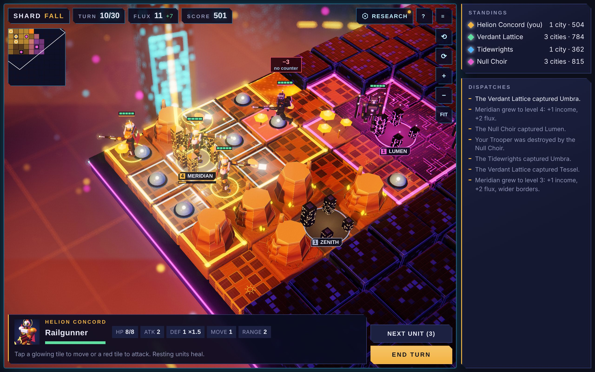
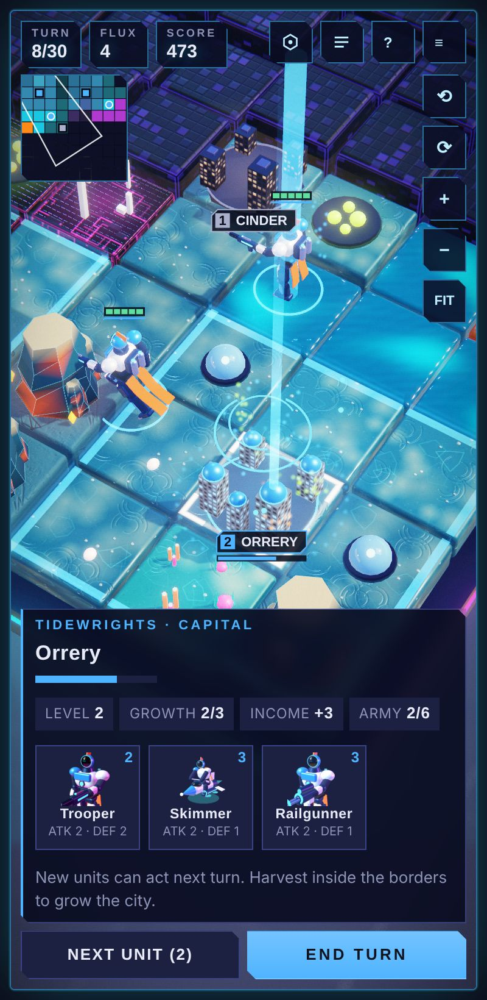
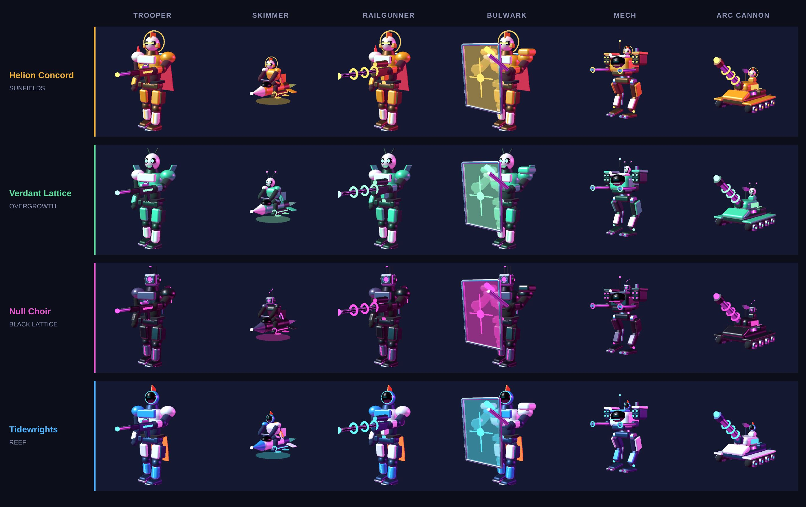
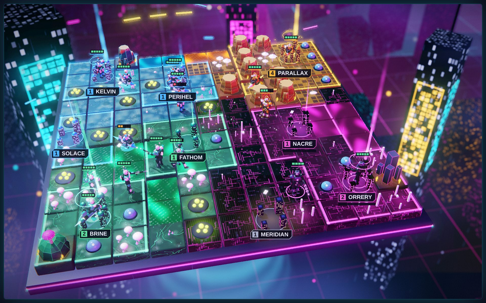
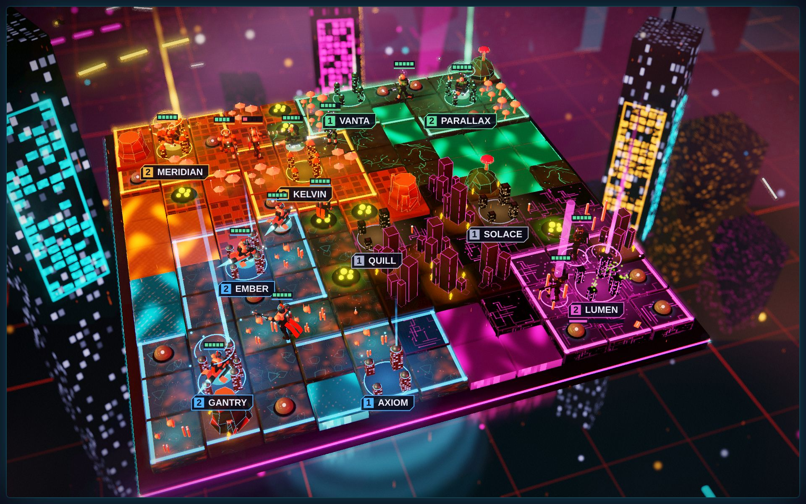
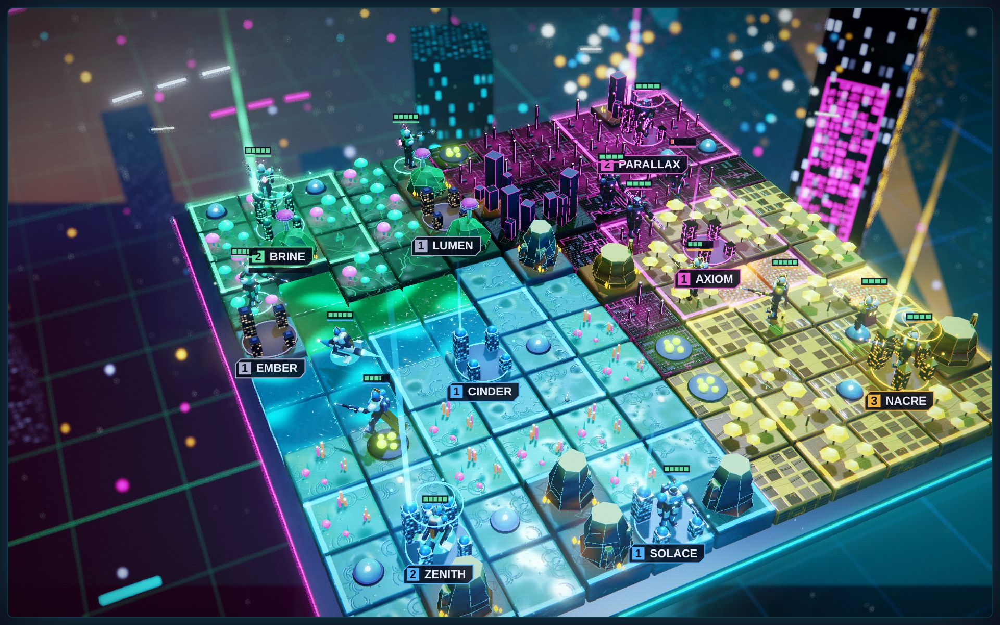
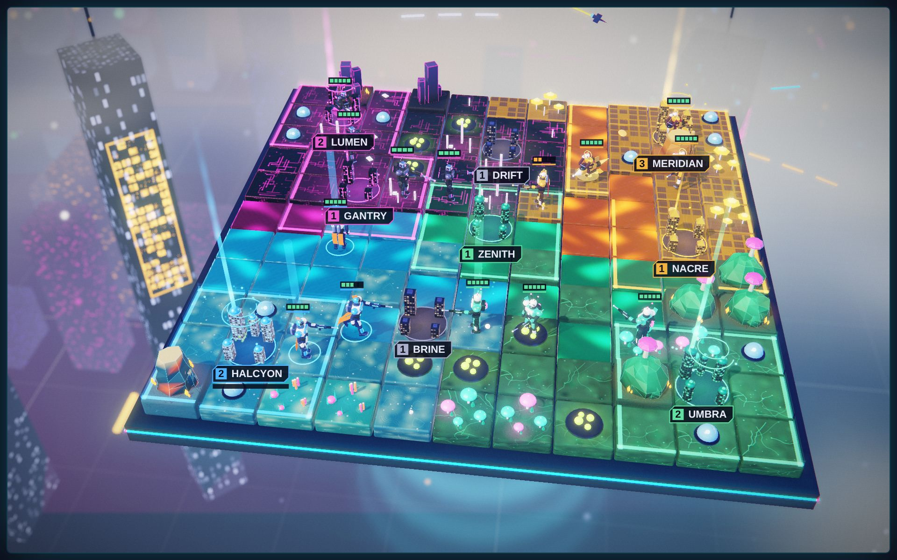

<h1 align="center">S H A R D F A L L</h1>

<p align="center">
  <b>Four future cultures. One broken slab of world. Thirty turns. Zero image files.</b><br>
  A turn-based conquest game for one commander, in one HTML file, in your browser.
</p>

<p align="center">
  <a href="https://github.com/clintecker/shardfall/actions/workflows/ci.yml"></a>
  
  
  
  
</p>



Somewhere above a city that has not noticed, four civilizations are fighting over a floating
square of real estate roughly the size of a chessboard and a half.

You are one of them. You have a Trooper, five flux, sixteen tiles you can see and a hundred
you cannot. There are outposts out there in the dark, and three other people who also want
them. One of those people is a hive mind. One of them grows its tanks. One of them is,
frankly, just rich.

You have thirty turns. Go.

## Contents

- [Play it](#play-it)
- [Meet the neighbors](#meet-the-neighbors)
- [How to play, in sixty seconds](#how-to-play-in-sixty-seconds)
- [Five skies](#five-skies)
- [What is in the box](#what-is-in-the-box)
- [How it is made](#how-it-is-made)
- [Hacking on it](#hacking-on-it)
- [Documentation](#documentation)
- [Questions nobody asked](#questions-nobody-asked)
- [License](#license)

## Play it

**The quick way.** Clone the repo and double-click `index.html`. That is not a figure of
speech. There is no build step between you and the game.

**The proper way.**

```bash
git clone https://github.com/clintecker/shardfall.git
```

```bash
cd shardfall && npm install && npm run dev
```

Then open <http://localhost:5173>.

**The original way.** Shardfall began life as a
[Claude artifact](https://claude.ai/artifact/Uv186B8dtPj42P5njqfAgL) and still ships as one.
That link opens for anyone the artifact has been shared with.

It plays with a mouse, a trackpad or a thumb. There is a phone layout, and it is rather
good:

<p align="center">
  
</p>

## Meet the neighbors



|                        | Who they are                                                                     | Their one unfair advantage                                                                      |
| ---------------------- | -------------------------------------------------------------------------------- | ----------------------------------------------------------------------------------------------- |
| 🟡 **Helion Concord**  | Solar-sail merchant priests who tithe every sunrise. Wear halos to work.         | **Dividend.** Their capital pays double. They would like you to know this is not luck.          |
| 🟢 **Verdant Lattice** | Gene-gardeners who grow their armor instead of forging it.                       | **Regrowth.** Every unit heals every turn. You will win a fight, come back, and find it un-won. |
| 🟣 **Null Choir**      | A machine collective that votes in a single voice. The vote is always unanimous. | **Fabricators.** Units cost less, because the factory is also the workforce.                    |
| 🔵 **Tidewrights**     | Drift-city navigators raised on drowned worlds.                                  | **Tideborn.** They walk on water. You see a lagoon; they see a shortcut.                        |

Each culture owns a quarter of every map, and it looks like theirs: gold mesas, glowing
mushroom forests, a circuit board the size of a country, a coral reef.
[Read the full, mostly accurate field guide.](docs/WORLD.md)

## How to play, in sixty seconds

1. **Tap your Trooper. Tap a glowing tile.** You have explored. Well done.
2. **Find an outpost and park on it.** Next turn, capture it. Cities make flux.
3. **Spend flux.** Tap your capital to train units. Open Research to unlock better ones.
4. **Harvest** the glowing resources inside your borders to grow your cities.
5. **Tap a red tile to attack.** The game shows you the damage both ways before you commit,
   so every bad trade is one you chose.
6. **Take every rival city**, or have the highest score when turn 30 ends.

The game teaches the rest as you go, and saves itself after every turn.
[Every rule and every number is written down](docs/GAMEPLAY.md), including the damage
formula and exactly how the rivals think.

## Five skies

Every game happens under one of five skies. A sky changes the light, the weather, the fog,
the reflections in every helmet and the mood of the whole war. It changes nothing about the
rules, and you will have a favorite anyway.

| Neon Storm                                                                          | Crimson Eclipse                                                                 |
| ----------------------------------------------------------------------------------- | ------------------------------------------------------------------------------- |
|  |  |
| **Aurora Night**                                                                    | **Cloud Dawn**                                                                  |
|        |                 |

(The fifth is Solar Dusk. It is in the hero shot at the top, being orange.)

## What is in the box

- **A complete little 4X.** Explore, expand, exploit, exterminate, be home for dinner.
  A whole war is thirty turns: one sitting.
- **Four cultures** that play differently and look nothing alike.
- **Six units**, from the humble Trooper to the Arc Cannon, which hits from three tiles away
  and has a defense of zero. The operator knows.
- **Twelve technologies** in four branches, and never enough flux for all of them.
- **Rivals that play by your rules.** Same costs, same income, same maths. (They do peek
  through the fog. [We wrote that down too.](docs/GAMEPLAY.md#the-rivals))
- **Honest combat.** A forecast on every attack and no dice in the fighting. If you lose a
  unit, it was arithmetic.
- **Three board sizes, four terrain presets, five skies.** Sixty kinds of afternoon.
- **A free camera.** Orbit, tilt, zoom, pinch, twist. The board is a real 3D object and it
  is fun to just look at.
- **Everything animates.** Fog lifts tile by tile. Borders flow outward. Cities celebrate.
- **Undo**, but only for moves that revealed nothing, so it can never be used to peek.
- **Autosave, keyboard shortcuts, a minimap, a tutorial coach, a reduced-motion mode** and a
  quality setting that looks after slow machines by itself.

## How it is made

With an unreasonable set of constraints, cheerfully accepted.

|                                  |                                                                                                                                      |
| -------------------------------- | ------------------------------------------------------------------------------------------------------------------------------------ |
| **Runtime dependencies**         | One: [three.js](https://threejs.org/) r147, from a CDN                                                                               |
| **Image, model and audio files** | Zero. Textures are painted on canvases at startup. Soldiers are assembled from boxes.                                                |
| **Framework**                    | None                                                                                                                                 |
| **Bundler**                      | None. The build concatenates files in the order `index.html` lists them.                                                             |
| **Shipping format**              | One HTML file, about 250 kB, unminified                                                                                              |
| **Animation system**             | A few lines spliced into three.js's vertex shader. A unit's whole body is one mesh that walks, aims and recoils entirely on the GPU. |
| **Post-processing**              | HDR bloom, then depth of field, ambient occlusion, lens streaks, filmic tone mapping and a color grade in a single shader pass       |
| **Tests**                        | 55, in three seconds, with no browser: every rule, 108 generated maps, and 40 full games played by the AI and audited every turn     |

The whole game is 24 plain JavaScript files sharing one global scope, like it is 2009, and
it is lovely. [The architecture doc explains why that was the right call](docs/ARCHITECTURE.md)
and what keeps it from turning into soup.
[The rendering doc explains how a page with no assets draws all this.](docs/RENDERING.md)

### A brief history of the art direction

Shardfall was built in conversation, one round of feedback at a time. The design reviews
were concise.

> "these graphics suck"
>
> "gotta be able to rotate the board. also improve the graphics"
>
> "100 more realistic and smooth and with defined cybervibes"
>
> "keep thinking of how to elevate the graphics"
>
> "very realistic and vibey"
>
> "the banners that go across the screen like YOUR MOVE are in the way"

Every one of those was correct. The [changelog](CHANGELOG.md) has the less quotable version.

## Hacking on it

```bash
npm run dev          # serve the source; edit, reload, repeat
```

```bash
npm test             # rules, map generation and whole-game simulations
```

```bash
npm run verify       # format check + static checks + tests + build (what CI runs)
```

```bash
npm run balance      # 200 AI-only games; who is overpowered this week?
```

```bash
npm run build        # dist/index.html and dist/shardfall.artifact.html
```

Every top-level name is a global, so the browser console is a cheat menu:

```js
G.factions[0].flux = 99; // be rich
G.factions[0].explored.fill(1); // lift the fog and watch the whole map rise
applyAtmo('eclipse'); // change the sky mid-game
```

Want to add a unit, a technology, a sky, or a fifth culture of very polite crabs?
[DEVELOPMENT.md](docs/DEVELOPMENT.md) has a recipe for each, and
[CONTRIBUTING.md](CONTRIBUTING.md) says what a good pull request looks like.

## Documentation

| Read this                                | If you want to know                                                             |
| ---------------------------------------- | ------------------------------------------------------------------------------- |
| [**GAMEPLAY**](docs/GAMEPLAY.md)         | Every rule, every number, the damage formula, how the rivals think              |
| [**WORLD**](docs/WORLD.md)               | Who these people are and why their mushrooms glow                               |
| [**ARCHITECTURE**](docs/ARCHITECTURE.md) | How the code is organized, the shape of the game state, why there is no bundler |
| [**RENDERING**](docs/RENDERING.md)       | How a page with no assets draws a neon war zone                                 |
| [**DEVELOPMENT**](docs/DEVELOPMENT.md)   | Setup, commands, recipes, shipping, troubleshooting                             |
| [**ROADMAP**](docs/ROADMAP.md)           | Known issues, balance numbers, what is next, what is never                      |
| [**CHANGELOG**](CHANGELOG.md)            | What changed and when                                                           |

## Questions nobody asked

**Is this Polytopia?**
No. It is an original game in the same family: small maps, short wars, one more turn. If
you like that kind of game, you already know where everything is.

**Why is the Verdant Lattice winning every game I watch?**
Because Regrowth is overtuned and the AI plays to its strengths. It wins about half of
AI-only four-way games, where a quarter would be fair. This is the
[top item on the roadmap](docs/ROADMAP.md#balance), with numbers and four proposed fixes.
In the meantime: play as Verdant and feel clever, or play against them and feel righteous.

**Where is the sound?**
There is none. Hum something.

**Why three.js r147? That is from 2022.**
It is the last version whose post-processing add-ons could be loaded with a plain
`<script>` tag, and the game has to ship as one file with no bundler. The
[rendering doc](docs/RENDERING.md#why-r147) has the details and the regrets.

**Will it run on my phone?**
It has a phone layout, touch gestures and a quality setting that steps itself down when
frames get slow. It has not been profiled on a wide range of real phones, and we would
rather say so than promise. Try it and
[tell us](https://github.com/clintecker/shardfall/issues).

**Can I play against a friend?**
Not yet. The rules are symmetric and the state is one JSON object, so hot-seat is very
doable. [It is on the list.](docs/ROADMAP.md#later)

**Thirty turns is not enough.**
That is the idea.

## License

[MIT](LICENSE). Take it, change it, grow your own tanks.
