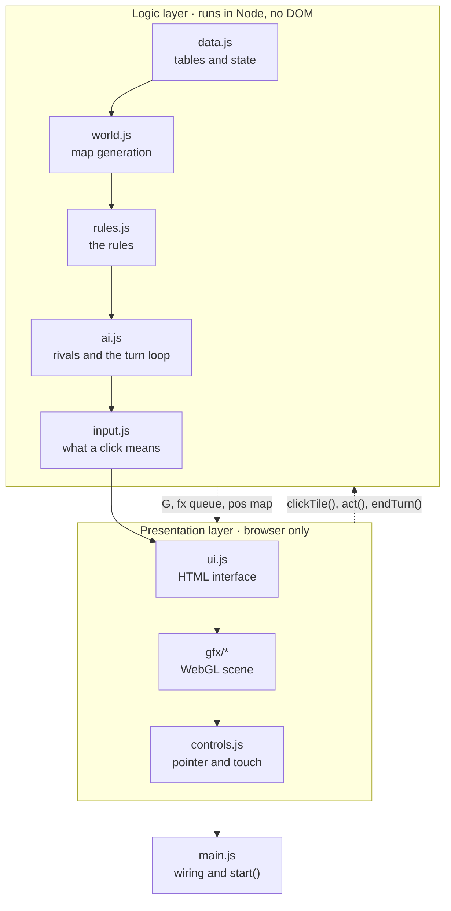
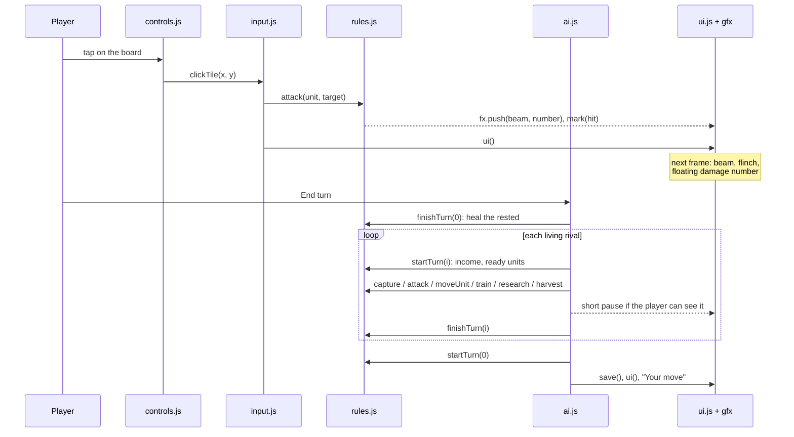

# Architecture

How Shardfall is put together, and why it is put together that way.

- [The shape of the thing](#the-shape-of-the-thing)
- [The constraint that explains everything](#the-constraint-that-explains-everything)
- [Repository map](#repository-map)
- [Layers](#layers)
- [One global scope, on purpose](#one-global-scope-on-purpose)
- [The game state: `G`](#the-game-state-g)
- [How rules talk to the screen](#how-rules-talk-to-the-screen)
- [A turn, end to end](#a-turn-end-to-end)
- [Saving and settings](#saving-and-settings)
- [The build](#the-build)
- [Testing strategy](#testing-strategy)
- [Performance model](#performance-model)
- [Accessibility](#accessibility)

## The shape of the thing

Shardfall is one web page. It has no server, no framework, no bundler, no image files, no
audio files and no model files. Its only runtime dependency is three.js r147, loaded from a
CDN. Everything you see is generated when the page loads: textures are painted onto canvases,
soldiers are assembled from boxes and cylinders, and the city in the background is a few
hundred instanced cubes with procedural windows.

The source is about 6,800 lines of plain JavaScript in 24 files, 1,400 lines of CSS and one
HTML page. The build step is string concatenation.

## The constraint that explains everything

Shardfall was born as a [Claude artifact](https://claude.ai/artifact/Uv186B8dtPj42P5njqfAgL):
a single self-contained HTML file hosted in a sandbox. That host sets the rules.

| Rule of the host                                    | What it means here                                       |
| --------------------------------------------------- | -------------------------------------------------------- |
| One HTML file                                       | All CSS and JS are inlined by the build                  |
| Scripts may only load from a handful of public CDNs | three.js comes from jsDelivr, pinned to an exact version |
| No other network requests for assets                | Every texture, model and effect is procedural            |
| The host supplies `<html>`, `<head>` and `<body>`   | The artifact build is a _fragment_, not a document       |

Rather than fight this with tooling, the project leans into it. If the output has to be one
script, the source can simply be that script cut into readable pieces. That gives a codebase
with no build system to learn, that runs by double-clicking `index.html`, and whose
"production bundle" is what you would get from `cat`.

It also means three.js is pinned to **r147**. That was the last release line to ship the
post-processing add-ons (`EffectComposer`, `UnrealBloomPass` and friends) as plain scripts
that attach to a global `THREE`. Newer releases are ES modules only, which a single inline
classic script cannot import. See [RENDERING.md](RENDERING.md#why-r147) for what that costs.

## Repository map

```
index.html              the page, and the build manifest (see "The build")
src/
  styles.css            all styling
  js/
    data.js             tables (cultures, units, techs) and shared state
    world.js            map generation, borders, fog of war
    rules.js            economy, movement, combat, cities, research, turn cycle
    ai.js               the rivals, and endTurn()
    input.js            what a click means; selection, undo, settings
    ui.js               the HTML interface: HUD, action bar, overlays, save/load
    gfx/                everything WebGL (see RENDERING.md)
      core.js             renderer state and helpers
      textures.js         procedural textures
      shaders.js          GLSL
      models.js           units built from primitives; GPU animation
      biomes.js           the four homelands
      engine.js           one-time renderer and post-processing setup
      atmosphere.js       the five skies
      particles.js        pooled particles
      backdrop.js         the city behind the board
      combatfx.js         beams, flashes, explosions
      portraits.js        unit portraits for the interface
      scene.js            the board for one game; terrain and territory
      units.js            unit meshes, reconciled with the game state
      sync.js             per-frame bridge from game state to scene
      camera.js           the orbit camera
      frame.js            the frame loop, adaptive quality, minimap, 2D overlay
    controls.js         pointer, touch and minimap input
    main.js             wires buttons and keys, then starts the game
scripts/
  build.mjs             src -> dist (two single-file pages)
  check.mjs             static checks for a shared-global-scope codebase
  serve.mjs             zero-dependency dev server
  balance.mjs           AI-vs-AI win-rate table
  screenshots.mjs       regenerates docs/media from the running game
test/
  *.test.mjs            unit tests and whole-game simulations (node:test)
  helpers/sandbox.mjs   loads the logic layer into a V8 context, no browser
  e2e/                  browser smoke test (bring your own Playwright)
docs/                   you are here
```

## Layers

Files are loaded in the order below. A file may use anything from the files above it at load
time, and anything at all once the game is running.



The line that matters is the one between the two boxes.

**The logic layer** owns the game state and every rule. It never touches the DOM or three.js
at load time, and at run time it calls exactly six presentation functions as fire-and-forget
notifications: `ui()`, `save()`, `showBanner()`, `showEnd()`, `focusOn()` and `renderTech()`.
Replace those six with stubs and the whole game runs headlessly, which is exactly what
[`test/helpers/sandbox.mjs`](../test/helpers/sandbox.mjs) does.

**The presentation layer** never changes the game state on its own. It reads `G` to draw,
and it calls three entry points when the player does something: `clickTile(x, y)`,
`act(verb, value)` and `endTurn()`.

Keeping to this is a convention, not something the language enforces. The test suite is the
enforcement: if a rule starts reaching into the renderer, the simulation tests stop loading.

## One global scope, on purpose

Every source file is a classic script. There are no `import` or `export` statements. A
`const` or `function` declared at the top of one file is visible in every file loaded after
it, exactly as if the files were pasted end to end. They are, in fact, pasted end to end by
the build.

This is unfashionable, so here is the reasoning:

- The shipping format is one inline `<script>`. ES modules cannot import each other from
  inside a single inline script, so modules would require a bundler, and the bundler would
  become the most complicated thing in the repository.
- The game is one program with one author-sized mental model, not a library. Its "API
  surface" is its own top-level names.
- The usual dangers of global scope are caught mechanically. `npm run check` parses the
  concatenated bundle as a single script, where a duplicate top-level `const` is a
  `SyntaxError`. It also verifies that every file in `src/js` is loaded exactly once.

The house rules that keep it pleasant:

1. **Declarations at the top level, execution in `main.js`.** Other files may compute
   constants when loaded, but only `main.js` attaches listeners and starts things. This is
   what makes load order easy to reason about.
2. **A new file goes in two places:** on disk, and as a `<script>` tag in `index.html` at
   the right point in the order. `npm run check` fails if you forget either.
3. **Short names are reserved for hot paths.** `G`, `GL`, `W3`, `T3` and `$` appear
   thousands of times. Everything else gets a real name.

| Global | Lives in      | What it is                                                       |
| ------ | ------------- | ---------------------------------------------------------------- |
| `G`    | `data.js`     | The entire game state. Also the save file                        |
| `sel`  | `data.js`     | The current selection: `{kind: 'unit' \| 'city' \| 'tile', ...}` |
| `fx`   | `data.js`     | Queue of visual effects the rules have requested                 |
| `pos`  | `data.js`     | Per-unit animation hints (`atkT`, `hitT`), keyed by unit id      |
| `SET`  | `input.js`    | Player settings (quality, effects, tips)                         |
| `T3`   | `gfx/core.js` | The `THREE` namespace                                            |
| `GL`   | `gfx/core.js` | Everything WebGL that lives as long as the page                  |
| `W3`   | `gfx/core.js` | Everything WebGL that lives as long as one game                  |
| `$`    | `data.js`     | `document.querySelector`                                         |

## The game state: `G`

One object, plain data all the way down. `JSON.stringify(G)` is the save file.

```js
G = {
  N: 11, // board is N x N
  turn: 1, // current turn, 1-based
  maxTurns: 30,
  uid: 5, // next unit id
  over: false,
  winner: -1, // faction index once over
  atmo: 'dusk', // which sky (see RENDERING.md)
  layout: 'balanced',
  bseed: 4.2, // seeds the wobble of the homeland borders
  coach: 0, // tutorial step, or -1 when finished
  log: ['...'], // last 7 messages, newest first

  tiles: [
    // N * N of these, row by row; index = y * N + x
    {
      t: 0, // terrain: 0 flats, 1 grove, 2 ridge, 3 liquid
      res: null, // 'algae', 'ore' or null
      o: -1, // id of the city whose borders contain this tile, or -1
      c: -1, // id of the city standing ON this tile, or -1
      used: 0, // 1 once harvested
      b: 0 // biome: index of the faction whose homeland this is
    }
  ],

  cities: [
    // a city's id is its index here; the first few are the capitals
    { id: 0, x: 1, y: 1, owner: 0, capital: true, name: 'Vanta', level: 1, pop: 0 }
  ], // owner is a faction index, or -1 for a neutral outpost

  units: [
    {
      id: 1,
      owner: 0,
      type: 'trooper',
      x: 1,
      y: 1,
      hp: 10,
      moved: false,
      attacked: false,
      fx: 1,
      fy: 0 // facing, as the last direction moved or fired
    }
  ],

  factions: [
    // index 0 is always the player
    {
      i: 0,
      key: 'helion',
      flux: 5,
      alive: true,
      kills: 0,
      techs: { excavation: 1 },
      explored: [0, 1, 1 /* ... N * N flags */],
      pref: ['thrusters' /* ... the AI's research wish list */]
    }
  ]
};
```

Some things worth knowing:

- **Tile ownership points at a city, not a faction.** `tile.o` is a city id. Who owns the
  tile is whoever owns that city right now (`tileFaction(tile)`), so capturing a city moves
  its whole territory without touching a single tile.
- **Faction index 0 is the player**, everywhere, always. The player's culture is whatever
  `G.factions[0].key` says.
- **There is no "visible" state**, only `explored`. Fog of war in Shardfall is exploration,
  not line of sight.
- **Nothing in `G` refers to anything outside `G`.** No object references into the renderer,
  no DOM nodes, no functions. That is what makes saving a one-liner and the simulation tests
  deterministic.

## How rules talk to the screen

The renderer mostly does not need to be told anything. Every frame it compares `G` with what
it drew last time and animates the difference: a tile whose `explored` flag flipped rises out
of the fog; a city whose `owner` changed gets a light column and re-colored borders; a unit
whose `x, y` changed glides to its new tile. This is why a rule can be as simple as
`u.x = x; u.y = y;` and still look good.

For events that leave no trace in the state, the rules use two small channels:

**`fx`, a queue of one-shot effects.** The rules push plain records and move on. The renderer
drains the queue on the next frame.

```js
fx.push({ x, y, text: '-4', color: '#ff5d73', t }); // a floating number
fx.push({ kind: 'beam', x1, y1, x2, y2, color, t }); // a shot
fx.push({ kind: 'burst', x, y, color, t }); // an explosion
fx.push({ kind: 'harvest', x, y, cx, cy, color, t }); // resources streaming to a city
```

**`pos`, a map of per-unit animation hints.** `mark(id, { atkT, tx, ty })` says "this unit
just fired at that tile"; `mark(id, { hitT })` says "this unit was just hit". The unit's
vertex shader turns those timestamps into a lunge, a recoil or a flinch.

Neither channel is saved, and neither is read by the rules. If the renderer vanished, the
queue would just grow, which is what happens in the tests.

## A turn, end to end

What happens when the player clicks a red target and then presses End turn:



`endTurn()` is the only `async` function in the logic layer. It awaits a 130 ms beat after
each rival action that happens on a tile the player has explored, so you can follow what the
rivals are doing. With reduced motion (and in tests) the beats are skipped and a rival turn
is instantaneous. While it runs, `busy` is true and all player input is ignored.

## Saving and settings

Everything is in `localStorage`, under three keys.

| Key                  | Contents                             | Written                                   |
| -------------------- | ------------------------------------ | ----------------------------------------- |
| `shardfall-save-v1`  | `JSON.stringify(G)`                  | When a game starts, and after every turn  |
| `shardfall-settings` | `{quality, weather, dof, ao, tips}`  | When a setting changes                    |
| `shardfall-coached`  | `'1'` once the tutorial has finished | Once; later games start without the coach |

Saves are forward-patched on load rather than versioned: `enter()` fills in anything an older
save lacks (for example, saves from before homelands existed get biomes assigned on entry).
If a change to `G` cannot be patched that way, bump the key to `-v2` so old saves are ignored
instead of crashing.

The save is deleted when a game ends or is abandoned from the menu; there is nothing to
resume.

When the page runs as a Claude artifact, it also registers with the host's hot-reload hook
(`window.claude.hot`) so that republishing a new version of the artifact keeps the game in
progress. Outside that host the hook is absent and the optional chaining makes it a no-op.

## The build

`index.html` is both the development page and the build manifest. `scripts/build.mjs` reads
it and writes two files:

| Output                         | For                             | Shape                                                  |
| ------------------------------ | ------------------------------- | ------------------------------------------------------ |
| `dist/index.html`              | Any static host, or `file://`   | A complete HTML document                               |
| `dist/shardfall.artifact.html` | Publishing as a Claude artifact | A fragment: no doctype, `<html>`, `<head>` or `<body>` |

The steps, in full:

1. Keep every `<script src="https://...">` tag from `index.html` as it is (the CDN scripts).
2. Inline `src/styles.css` into a `<style>` tag.
3. Copy the markup between `<!-- app:start -->` and `<!-- app:end -->`.
4. Concatenate every `<script src="src/js/...">` file, in order, into one inline script
   under a single `'use strict'`, with a banner comment naming each file.

There is no minification. The game is about 250 kB unminified against a 16 MB limit, and a
readable bundle is worth more than the bytes.

The build is deterministic: no timestamps, no hashes. Building twice gives identical files,
and the test suite checks that.

## Testing strategy

Three rings, from fast and narrow to slow and broad.

| Ring                | Command            | Runs in  | Takes   | Catches                                               |
| ------------------- | ------------------ | -------- | ------- | ----------------------------------------------------- |
| Static checks       | `npm run check`    | Node     | < 1 s   | Missing or duplicate scripts, name collisions, syntax |
| Unit and simulation | `npm test`         | Node     | ~ 3 s   | Wrong rules, unfair maps, corrupt state, hung games   |
| Browser smoke       | `npm run test:e2e` | Chromium | minutes | Load order, WebGL startup, real input, console errors |

The middle ring is the interesting one. Because the logic layer is DOM-free, the tests load
the real source files into a `vm` context with a seeded random number generator and play:

- **Rule tests** set up a blank arena and check one rule at a time against the numbers in
  [GAMEPLAY.md](GAMEPLAY.md).
- **World tests** generate 108 maps across every size, layout and rival count and check the
  fairness guarantees.
- **Simulation tests** play 40 complete games with the AI in every seat and audit the entire
  state after every turn: no two units on one tile, no negative flux, no dead faction with
  an army, no unit standing on terrain it cannot enter, and every game over by turn 30.

That last ring found a real bug the first time it ran (see the
[changelog](../CHANGELOG.md)), which is the best argument for it.

The renderer has no unit tests. It is verified by the smoke test and by looking at it;
[DEVELOPMENT.md](DEVELOPMENT.md#checking-visual-changes) describes the routine.

## Performance model

The target is 60 frames per second on a laptop with integrated graphics, and something
playable on a phone.

- **Draw calls are bounded by variety, not by board size.** Terrain, scenery, towers and
  traffic are `InstancedMesh`es: one draw call per kind of thing. A unit is one merged
  geometry (plus glow and hologram layers).
- **Very little allocation while playing.** Particles, beams and flashes come from fixed
  pools, and scratch vectors and matrices are shared and reused, so the garbage collector
  has little reason to interrupt a frame.
- **Animation is in the shaders.** Walk cycles, breathing, recoil, cloth, energy pulses and
  flowing liquid cost nothing on the CPU.
- **Work scales with what is changing.** Terrain instances are only refilled on frames
  where a tile is mid-transition.
- **Quality adapts.** If frames stay slow, the game lowers the resolution, then turns off
  bloom and shrinks the shadow map. The menu can pin it high or low instead.

## Accessibility

What is in place:

- Every button, panel and overlay is reachable from the keyboard, with a visible focus ring,
  and there are shortcuts for the whole turn loop (next unit, end turn, undo, research).
- `prefers-reduced-motion` removes camera glides, pulsing, banner motion and AI pauses.
- Announcements ("Your move", "City captured") are an `aria-live` region.
- Faction colors are always paired with a name in the interface, and health is shown as a
  bar and a number, not a color.

What is not:

- **The board needs a pointer.** There is no keyboard cursor for choosing a tile, so moving
  and attacking cannot be done from the keyboard alone.
- **The board is a WebGL canvas** and its contents are not exposed to screen readers.
- Contrast has been tuned by eye, not audited.

A keyboard cursor and a parallel text interface would both sit on top of
`clickTile()` and `act()`, which the logic layer already exposes. Nobody has built either
yet; both are on the [roadmap](ROADMAP.md).
