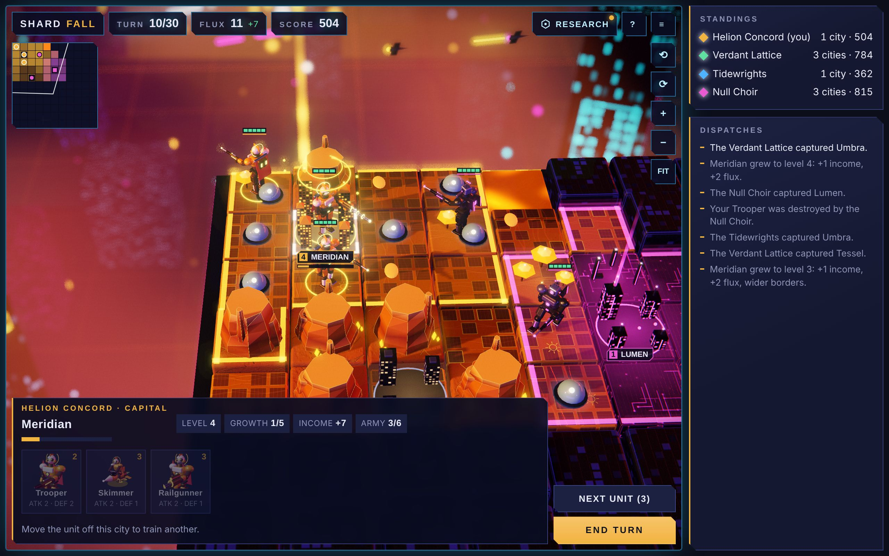
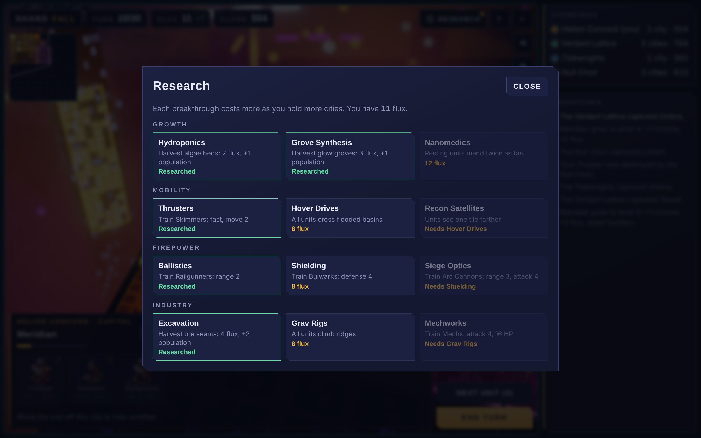
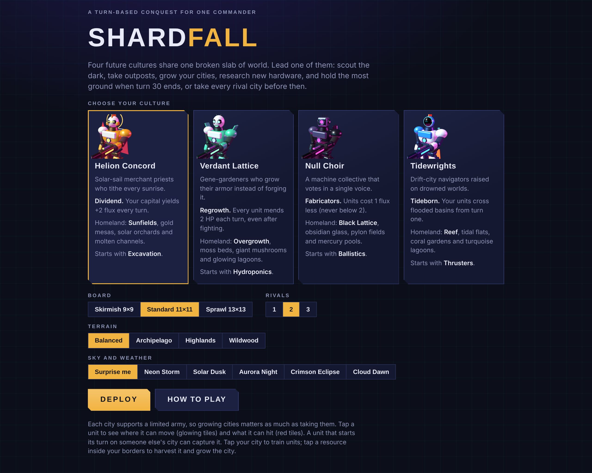

# How Shardfall plays

The complete rules, with every number. If this page and the game ever disagree, the game is
right and this page has a bug: each rule here is pinned by a test in
[`test/rules.test.mjs`](../test/rules.test.mjs), and the code lives in
[`src/js/rules.js`](../src/js/rules.js).

- [The short version](#the-short-version)
- [Winning](#winning)
- [The board](#the-board)
- [A turn](#a-turn)
- [Units](#units)
- [Moving](#moving)
- [Fighting](#fighting)
- [Cities](#cities)
- [Flux](#flux)
- [Research](#research)
- [The four cultures](#the-four-cultures)
- [The rivals](#the-rivals)
- [Controls](#controls)
- [Things the game does not tell you](#things-the-game-does-not-tell-you)

## The short version

You have 30 turns. Walk into the dark, sit on outposts until they are yours, spend flux on
soldiers and science, and either take every rival city or have the highest score when the
clock runs out.

## Winning

There are two ways for a game to end.

**Conquest.** The moment you own every rival's last city, you win. The moment you lose your
own last city, you lose, and the win goes to the surviving rival with the highest score.

**The clock.** When turn 30 ends, the living side with the highest score wins.

| Worth                   | Points |
| ----------------------- | ------ |
| Each city you hold      | 100    |
| Each level of each city | 40     |
| Each technology         | 30     |
| Each living unit        | 10     |
| Each kill               | 15     |
| Each tile you explored  | 2      |

So a fresh level-1 city is worth 140, and growing it to level 3 makes it 220.

A side with no cities scores zero and is out of the game; its army vanishes with it.

Exploring matters more than it looks. A fully explored 11×11 board is 242 points, which is
more than an extra city.

## The board

The board is a square grid: 9×9 (Skirmish), 11×11 (Standard) or 13×13 (Sprawl). Distance is
measured in king moves, so diagonals cost the same as straights. A unit "2 tiles away" might
be two steps east, or two steps diagonally.

Every tile is one of four terrains. Each culture has its own names and look for them, but
they work the same everywhere.

| Terrain    | Moving in                                                 | Defending on it | Notes                          |
| ---------- | --------------------------------------------------------- | --------------- | ------------------------------ |
| **Flats**  | Free                                                      | ×1              | May hold an algae bed          |
| **Grove**  | Ends your move                                            | ×1.25           | Can be harvested once          |
| **Ridge**  | Needs _Grav Rigs_; ends your move                         | ×1.5            | Sight +1. May hold an ore seam |
| **Liquid** | Needs _Hover Drives_ (or be a Tidewright); ends your move | ×1              |                                |

"Ends your move" only matters to Skimmers, the one unit that moves 2. Everyone else moves 1
and was stopping anyway.

### Terrain presets

| Preset      | What you get                                                        |
| ----------- | ------------------------------------------------------------------- |
| Balanced    | A bit of everything                                                 |
| Archipelago | Much more liquid. Tidewrights smile. Everyone else researches boats |
| Highlands   | Much more ridge. Slow, defensible, rich in ore                      |
| Wildwood    | About twice the groves. Cover everywhere                            |

### What every side is promised

However the dice fall, map generation guarantees that each capital:

- sits one tile in from a corner,
- has exactly **one ore ridge**, at least **two algae beds** and at least **one grove**
  among its eight neighbors, and no liquid,
- has a walkable road to the middle of the board for a plain Trooper with no research.

Neutral **outposts** are scattered across the rest (about one per 15 tiles), never closer
than 3 tiles to another city.

### Fog of war

You see what you have explored, permanently. Units reveal the tiles within 1 of them when
they arrive anywhere, 2 if they are standing on a ridge, and +1 more with _Recon
Satellites_. Cities reveal their borders plus one tile. Capturing a city reveals the land
around it.

Explored tiles stay lit after your units leave, and you can see enemy units on any tile you
have explored. You cannot shoot at a tile you have never seen.

## A turn

1. You collect flux from your cities, and all your units are readied.
2. You act, in any order: move and attack with units, capture, train, harvest, research.
3. You press **End turn**. Units that did nothing heal.
4. Each rival takes a full turn the same way.
5. The turn counter goes up.

Each unit may **move once and attack once** per turn, in that order: attacking ends the
unit's turn, so move first.

## Units

| Unit           | Cost | Attack | Defense | HP  | Move | Range | Unlocked by    |
| -------------- | :--: | :----: | :-----: | :-: | :--: | :---: | -------------- |
| **Trooper**    |  2   |   2    |    2    | 10  |  1   |   1   | From the start |
| **Skimmer**    |  3   |   2    |    1    | 10  |  2   |   1   | Thrusters      |
| **Railgunner** |  3   |   2    |    1    |  8  |  1   |   2   | Ballistics     |
| **Bulwark**    |  3   |   1    |    4    | 14  |  1   |   1   | Shielding      |
| **Mech**       |  6   |   4    |    3    | 16  |  1   |   1   | Mechworks      |
| **Arc Cannon** |  7   |   4    |    0    |  8  |  1   |   3   | Siege Optics   |

Roughly: Troopers hold ground, Skimmers find things, Railgunners and Arc Cannons hurt people
who cannot hurt them back, Bulwarks refuse to die, and Mechs are the answer to most
questions that start with "how do I take that city".

### Supply

Your army is capped. You can field

> **1 + (level + 1) for each city you own**

units. One level-1 capital supports 3. Grow it to level 2 and it supports 4. A second city
adds at least 2 more. If you lose a city your existing units stay, but you cannot train
replacements until you are back under the cap.

## Moving

Select a unit and its reachable tiles glow. A unit can step to any of the eight tiles around
it, if the terrain allows and nothing is standing there. Skimmers get two steps, as long as
the first one lands on flats.

A move can be **undone** (`Z`, or the Undo button) if it revealed nothing new. If it lifted
any fog, it is final. This means undo can never be used to peek.

## Fighting

Select a unit and anything it can hit glows red. Hover or tap a target to see the
**forecast**: the damage you will deal and the damage you will take, before you commit.

### The damage formula

```
damage = attack × (0.5 + 0.5 × attacker's health fraction) × 6 ÷ (1 + defense × cover)
```

rounded to the nearest whole number, and never less than 1.

- **Health matters.** A unit at full health hits at 100%. At half health, 75%. Nearly dead,
  just over 50%.
- **Cover** is ×1.5 on a ridge or inside your own city, ×1.25 in a grove, ×1 otherwise.
  Standing in a city only helps the side that owns it.
- **Counter-attacks** happen if the defender survives and the attacker is within the
  defender's range. They use the same formula at ×0.75, and they use the defender's health
  _after_ your hit landed.

Some worked examples, attacker at full health:

| Attacker   | Defender                  | Working             | Damage |
| ---------- | ------------------------- | ------------------- | :----: |
| Trooper    | Trooper in the open       | 2 × 6 ÷ (1 + 2)     |   4    |
| Trooper    | Trooper in a grove        | 12 ÷ (1 + 2 × 1.25) |   3    |
| Trooper    | Trooper on a ridge        | 12 ÷ (1 + 2 × 1.5)  |   3    |
| Mech       | Trooper in their own city | 24 ÷ (1 + 2 × 1.5)  |   6    |
| Arc Cannon | Bulwark on a ridge        | 24 ÷ (1 + 4 × 1.5)  |   3    |
| Trooper    | Arc Cannon anywhere       | 12 ÷ (1 + 0)        |   12   |

That last row is why Arc Cannons need bodyguards.

### After the shooting

- If a **melee** unit (range 1) kills its target, it steps into the vacated tile, provided
  it could legally walk there.
- Ranged units stay where they are.
- A range-2 or range-3 unit attacking from outside its target's range takes no
  counter-attack at all.

### Healing

A unit that **neither moved nor attacked** this turn heals when you end the turn:

- **2 HP** in the field,
- **4 HP** inside your own borders,
- doubled by _Nanomedics_.

## Cities

### Capturing

To take a city (a neutral outpost or a rival's), a unit must **begin its turn standing on
it**. Walk on this turn; capture next turn. Capturing uses the unit's whole turn. You cannot
capture with a unit that has already moved or attacked.

Nothing stops a rival from shooting your unit off the tile in between. That is the game.

### Growing

Cities have a **level** and a **population**. A city at level _L_ needs _L + 1_ population
to reach the next level. Each new level:

- raises the city's income by 1 flux per turn,
- raises your supply cap by 1,
- pays a one-off 2 flux,
- and at **level 3**, pushes the city's borders out from the 3×3 around it to 5×5.

Borders never take tiles another city already claimed.

### Harvesting

Population comes from harvesting resources **inside that city's borders**.

| Resource  | Found on         | Needs           | Costs  | Gives         |
| --------- | ---------------- | --------------- | :----: | ------------- |
| Algae bed | Flats            | Hydroponics     | 2 flux | +1 population |
| Grove     | Any grove tile   | Grove Synthesis | 3 flux | +1 population |
| Ore seam  | Some ridge tiles | Excavation      | 4 flux | +2 population |

Each resource can be harvested once. A harvested grove stays a grove (and keeps its cover
bonus); it just cannot be harvested again.

### Training



Select one of your cities to train a unit there. You need the unit's tech, the flux, room
under your supply cap, and an empty city tile. New units appear in the city and **cannot act
until your next turn**.

## Flux

Flux is the only currency. You start with 5.

Each turn every city pays its **level**, and a capital pays **+1** on top. (A Helion capital
pays +2 more.) So one level-1 capital is 2 flux a turn; add a level-2 outpost and it is 4.

Flux buys units, research and harvests. There is no upkeep and no interest: flux in the bank
does nothing for you, and it is not worth points.

## Research



Twelve technologies in four branches of three. You must research a branch in order.

| Branch        | Tier 1                              | Tier 2                                   | Tier 3                                           |
| ------------- | ----------------------------------- | ---------------------------------------- | ------------------------------------------------ |
| **Growth**    | **Hydroponics**: harvest algae beds | **Grove Synthesis**: harvest groves      | **Nanomedics**: resting units heal twice as fast |
| **Mobility**  | **Thrusters**: train Skimmers       | **Hover Drives**: all units cross liquid | **Recon Satellites**: units see 1 tile farther   |
| **Firepower** | **Ballistics**: train Railgunners   | **Shielding**: train Bulwarks            | **Siege Optics**: train Arc Cannons              |
| **Industry**  | **Excavation**: harvest ore seams   | **Grav Rigs**: all units climb ridges    | **Mechworks**: train Mechs                       |

A technology costs

> **tier × (3 + the number of cities you own)**

flux. With one city, tier 1 costs 4, tier 2 costs 8, tier 3 costs 12. With four cities they
cost 7, 14 and 21. Expanding makes science dearer, so there is a real choice between
researching early while it is cheap and grabbing land first.

## The four cultures



Every culture starts with one technology and has one permanent trait. They also each own a
quarter of the map: see [WORLD.md](WORLD.md) for who these people are and why their
mushrooms glow.

| Culture             | Trait           | What it does                                         | Starts with |
| ------------------- | --------------- | ---------------------------------------------------- | ----------- |
| **Helion Concord**  | **Dividend**    | Your capital yields +2 flux every turn               | Excavation  |
| **Verdant Lattice** | **Regrowth**    | Every unit heals 2 HP each turn, even after fighting | Hydroponics |
| **Null Choir**      | **Fabricators** | Units cost 1 flux less (never below 2)               | Ballistics  |
| **Tidewrights**     | **Tideborn**    | Your units cross liquid from turn one                | Thrusters   |

Some honest advice:

- **Helion** is the simplest to play well. Double income from turn one, and Excavation means
  the ore ridge next to your capital is an immediate level-up.
- **Verdant** wins wars of attrition. Trade blows; you get yours back. See
  [the balance note](#things-the-game-does-not-tell-you).
- **Null Choir** starts with Railgunners available, at a discount. The Trooper discount does
  nothing (2 is the floor), so tech toward the expensive hardware.
- **Tidewrights** are map-dependent. On Archipelago they walk where others cannot follow.
  On Highlands their trait is a nice story.

## The rivals

Rivals follow the same rules you do: same costs, same income, same supply cap, same combat
maths. They have one advantage, and you should know about it: **they are not bound by fog of
war.** They know where every city is from turn one, and they can fire at anything in range.

Each rival unit, every turn:

1. captures the city it is standing on, if it can;
2. otherwise takes the best attack on offer. It loves a kill (worth triple), and it will not
   attack at all if the counter-attack would kill it or would hurt more than the attack does;
3. otherwise stays put if it is garrisoning a city with enemies within 2 tiles;
4. otherwise walks toward the nearest city it does not own (preferring neutral ones), or
   toward an intruder near its own cities, or toward unexplored ground;
5. then attacks again if the move brought something into range.

After its units, a rival trains what it can afford (favoring its most expensive available
unit), researches the next technology on its wish list, harvests whatever it can pay for with
1 flux to spare, and trains again. The wish list is shuffled when the game starts, but always
broad before deep: every tier-1 technology, then the tier 2s, then the tier 3s. That is why
no two rivals field quite the same army, and why none of them rushes Mechs.

The rivals are competent, not clever. They do not coordinate, do not retreat wounded units,
and do not defend against threats they can see coming. Beat them with focus fire and with
patience.

## Controls

|                                   | Mouse                         | Touch            | Keyboard                  |
| --------------------------------- | ----------------------------- | ---------------- | ------------------------- |
| Select, move, attack              | Click                         | Tap              |                           |
| Pan                               | Drag                          | Drag             | `W` `A` `S` `D` or arrows |
| Orbit and tilt                    | Right-drag, or `Shift` + drag | Two-finger twist | `Q` `R` to spin           |
| Zoom                              | Scroll                        | Pinch            |                           |
| Zoom in on a spot                 | Double-click                  |                  |                           |
| Jump the camera                   | Click the minimap             | Tap the minimap  |                           |
| Fit the board on screen           | **Fit** button                | **Fit** button   | `F`                       |
| Next unit that can still act      | **Next unit**                 | **Next unit**    | `Space`, `N` or `Tab`     |
| End turn                          | **End turn**                  | **End turn**     | `Enter` or `E`            |
| Undo a move that revealed nothing | **Undo**                      | **Undo**         | `Z`                       |
| Research                          | **Research**                  | Research icon    | `T`                       |
| Help                              | **?**                         | **?**            | `H` or `?`                |
| Deselect, close a panel           |                               |                  | `Esc`                     |

The game saves itself to your browser after every turn. Close the tab; **Resume** will be
waiting on the title screen.

The **menu** (☰) has a quality switch (Auto, High, Low) and toggles for weather, focus blur
(depth of field), soft shadows (ambient occlusion) and the coach tips. Auto steps the quality
down by itself if your machine is struggling. If your operating system is set to reduce motion, the game drops its camera
glides, pulsing and screen effects.

## Things the game does not tell you

- **The End turn button lights up** when none of your units has anything left to do.
- **A dot on the Research button** means you can afford something.
- **Capitals are not special to capture.** They fall exactly like outposts. Leave someone
  home.
- **Rivals can be eliminated early.** Take a rival's only city on turn 8 and their whole
  army disappears.
- **The first sign of an enemy is usually their border.** Territory outlines are visible on
  any explored tile.
- **Verdant is overtuned when the AI plays it.** In simulated four-way games with every
  seat played by the AI, the Verdant Lattice wins about half the time, where a fair table
  would be a quarter. Regrowth is very strong for a player who fights every turn, which is
  how the AI plays. This is a known issue, tracked in [ROADMAP.md](ROADMAP.md); run
  `npm run balance` to see the current numbers. If you want a harder game, give yourself the
  Null Choir and three rivals.
