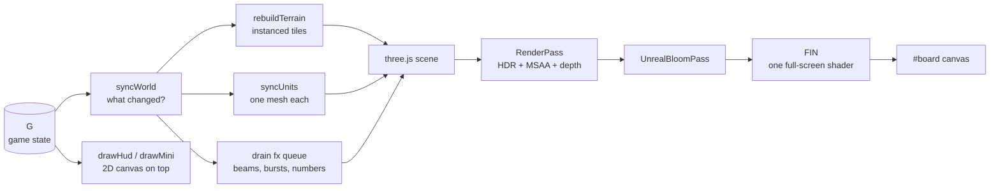
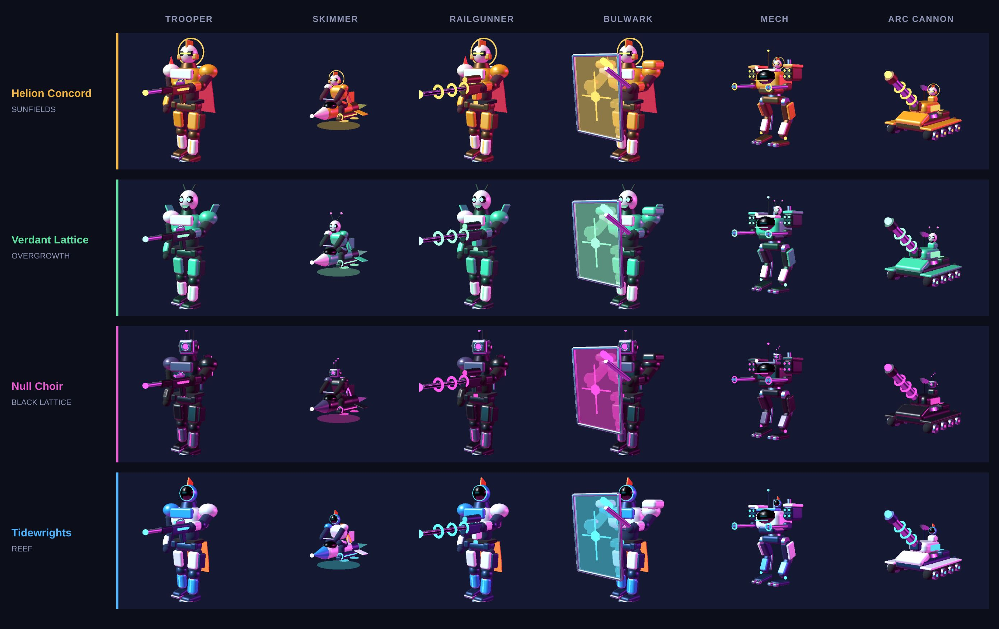
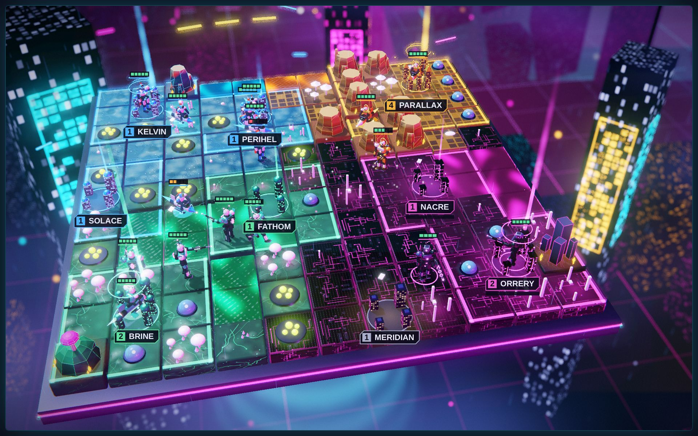
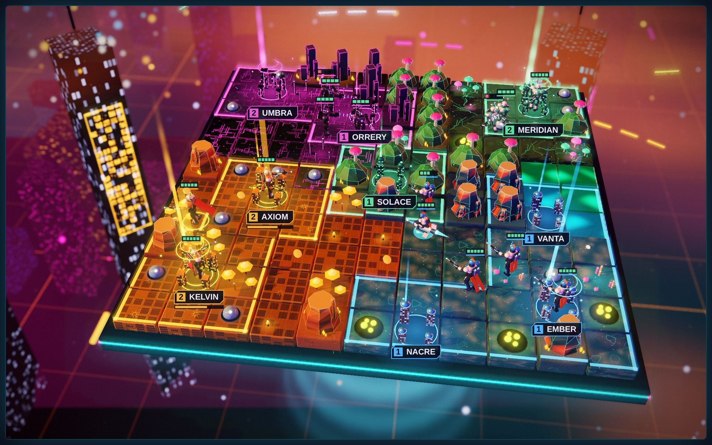
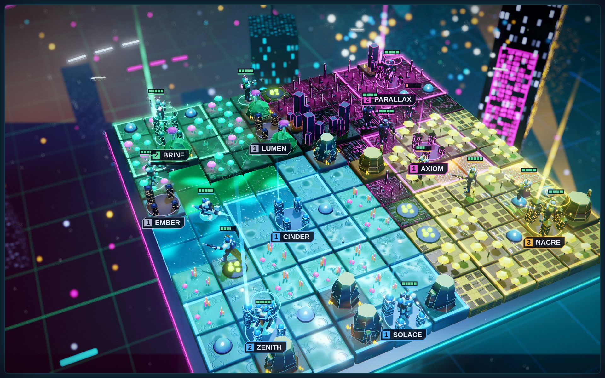
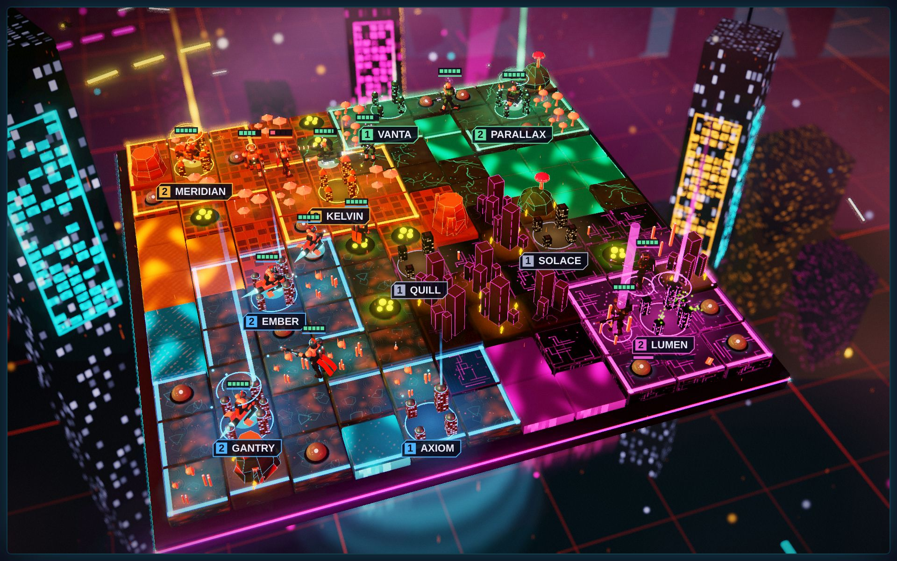
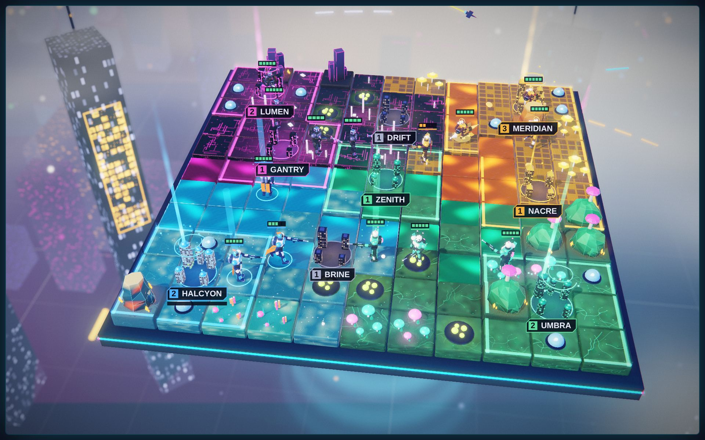

# Rendering

How a page with no image files, no model files and one library draws a neon war zone.

Everything here lives in [`src/js/gfx/`](../src/js/gfx). The rules of the game never call
into it; see [ARCHITECTURE.md](ARCHITECTURE.md#how-rules-talk-to-the-screen) for the two
small channels that connect them.

- [A frame, start to finish](#a-frame-start-to-finish)
- [Why r147](#why-r147)
- [Nothing is loaded; everything is made](#nothing-is-loaded-everything-is-made)
- [Characters that animate themselves](#characters-that-animate-themselves)
- [The board](#the-board)
- [Transitions](#transitions)
- [Homelands](#homelands)
- [Skies](#skies)
- [The city behind the board](#the-city-behind-the-board)
- [Post-processing](#post-processing)
- [The 2D layer](#the-2d-layer)
- [Quality levels and fallbacks](#quality-levels-and-fallbacks)
- [Poking at it](#poking-at-it)
- [Recipes](#recipes)

## A frame, start to finish

`frame()` in [`frame.js`](../src/js/gfx/frame.js) runs on `requestAnimationFrame`.



In order, each frame:

1. **Ease the camera** toward where it wants to be.
2. **`syncWorld`** compares the game state with what was drawn last frame and starts
   transitions for anything that changed.
3. **Step the ambient life**: air traffic, dogfights, searchlights, particles, weather.
4. **Render** through the post-processing chain.
5. **Draw the 2D overlay** (health bars, labels, damage numbers) and the minimap.

Nothing in the frame loop decides anything about the game. You could delete `gfx/` and the
rules would not notice, which is how the tests run.

## Why r147

Shardfall uses [three.js](https://threejs.org/) r147 (December 2022), loaded as nine classic
scripts from jsDelivr.

That exact version is deliberate. The game has to ship as one HTML file with one inline
script, so it needs three.js and its post-processing add-ons as plain `<script>` files that
attach to a global `THREE`. r147 is the last release that published the add-ons that way
(`examples/js/`); from r148 they are ES modules only.

Living on r147 has two consequences you will trip over:

**Colors are in "legacy" mode.** Modern three.js converts sRGB colors to linear for you.
r147 does not, by default. So every color in the codebase goes through one helper:

```js
const lin = (hex, m = 1) => new T3.Color(hex).convertSRGBToLinear().multiplyScalar(m);
```

If something you added looks washed out and too bright, you passed a raw hex to a material.
The multiplier is how emissive surfaces get brighter than white, which is what feeds bloom.

**The renderer does no tone mapping or output encoding.** `outputEncoding` is `Linear` and
`toneMapping` is `None`, because the whole scene is rendered to a floating-point target and
the final shader does both jobs itself, after bloom. Doing it twice is the other way to get
washed-out colors.

## Nothing is loaded; everything is made

**Textures** ([`textures.js`](../src/js/gfx/textures.js)) are painted with the 2D canvas API
when the page starts, then uploaded. Plating is rectangles with panel lines and bolts; tower
windows are a grid of randomly lit cells; water is layered ripples. `nrmFrom()` turns a
grayscale height canvas into a normal map by differencing neighboring pixels, so every
painted surface also catches the light properly.

All of it is seeded (`rng(seed)` in [`core.js`](../src/js/gfx/core.js)), so the world looks
the same on every load.

**Reflections** come from an environment map the game renders itself: a small scene of a sky
sphere and a few colored light panels is baked through `PMREMGenerator`. It is re-baked
whenever the sky changes, so chrome under an aurora reflects green.

**Models** are next.

## Characters that animate themselves

A Trooper is dozens of boxes, capsules and cylinders. Drawing them as separate meshes would
be dozens of draw calls per unit. Animating them with a skeleton would need bones,
skinning weights and per-frame matrix updates.

Shardfall does neither. [`models.js`](../src/js/gfx/models.js) has a small `Builder` that
merges all of a unit's primitives into **one geometry**, and while doing so stamps four extra
numbers onto every vertex:

| Attribute | Meaning                                                                        |
| --------- | ------------------------------------------------------------------------------ |
| `color`   | The vertex's base color (so one material can paint the whole unit)             |
| `aPart`   | Which body part this vertex belongs to                                         |
| `aPivot`  | The joint that part rotates around (hip, shoulder, neck)                       |
| `aPivot2` | A second joint, for two-bone chains (a shin rotates at the knee, then the hip) |
| `aMat`    | Surface finish: roughness, metalness and clearcoat                             |

Then `animPatch()` uses three.js's `onBeforeCompile` hook to splice a few lines into the
stock physically-based vertex shader. Those lines read `aPart` and rotate the vertex around
its pivot by an angle taken from a uniform:

| `aPart` | Body part        | Driven by                                 |
| :-----: | ---------------- | ----------------------------------------- |
|    0    | Torso, static    | (only the whole-body bob)                 |
|  1, 2   | Left, right leg  | Hip swing                                 |
|  3, 4   | Left, right arm  | Arm swing, aim, recoil                    |
|    5    | Head, turret     | Yaw: looking around, tracking a target    |
|    6    | Weapon           | Slides back along its pivot: recoil kick  |
|  7, 8   | Left, right shin | Knee bend, then hip swing (two pivots)    |
|    9    | Cloth            | A travelling sine wave: capes and banners |

The CPU's whole contribution to animating a unit is setting three `vec4` uniforms (`uA`,
`uB`, `uC`) per frame from the per-type table `RIG` in
[`units.js`](../src/js/gfx/units.js): stride length, knee bend, recoil distance, cadence.
A Mech's knee value is negative, which is all it takes to make its legs bend backwards.

The same patch forwards `aMat` to the fragment shader, so a single material renders matte
cloth, brushed armor and glossy visor glass on the same mesh.

Each unit has two more small meshes: a **glow** layer (unlit, brighter than white, picked up
by bloom) for visors, muzzles and thrusters, and for some units a **holo** layer (additive,
animated) for shields and sights.

`unitGeo(type, culture)` builds and caches the result, so the whole roster costs 24
sets of geometry however many units are on the board. Each culture gets its own palette (`PAL`),
head (`head()`) and accessories (`kit()`): Helion wear halos and capes, Verdant have
antennae and bulb heads, the Null Choir are faceless boxes with one eye, and Tidewrights
wear dive helmets.



_Rows: Helion Concord, Verdant Lattice, Null Choir, Tidewrights. Columns: Trooper, Skimmer,
Railgunner, Bulwark, Mech, Arc Cannon. This image is produced by the game's own portrait
renderer; see [Recipes](#recipes)._

## The board

[`scene.js`](../src/js/gfx/scene.js) builds the board for one game and throws it away when
the game ends.

Terrain is **instanced**: one `InstancedMesh` for each kind of thing (flat tile, grove tile,
ridge, liquid, each biome's trees, rocks and crystals), with one instance per tile that needs
it. A 13×13 board with scenery is a few dozen draw calls, not a few thousand. The helper

```js
put(mesh, x, y, z, rotY, sx, sy, sz, color);
```

appends one instance with a transform and a per-instance color, and is used for nearly
everything on the board.

Tile surfaces get two more shader patches from `models.js`: `pulsePatch` sends a slow energy
pulse through the seams, and `flowPatch` scrolls an emissive pattern across liquid so molten
channels and mercury pools look like they are moving.

**Territory** is a separate mesh rebuilt when borders change: for every edge between a tile
you own and one you do not, it emits a glowing wall segment in the owner's color, with a
shader that makes it shimmer upward.

**Unexplored tiles** are dark blocks with a circuit pattern, sitting higher than the terrain
they hide.

## Transitions

The request that shaped this part of the renderer was: _when fog of war lifts, it should
animate, and so should everything like it_.

The solution is to give every tile its own clocks and refill the instances from scratch on
any frame where a clock is running.

| Clock  | Started when                                | Duration |
| ------ | ------------------------------------------- | :------: |
| `rev`  | The tile becomes explored                   |  820 ms  |
| `chg`  | The tile's resource is harvested            |  480 ms  |
| `ownT` | The tile changes hands (drives the borders) |  a fade  |

During a reveal, three things happen in sequence, each eased:

1. the fog block sinks and shrinks away,
2. the terrain tile rises out of the deck,
3. its scenery (trees, rocks, crystals) pops up with a slight overshoot.

Because the terrain is rebuilt from state rather than mutated, every transition is just "what
should this instance look like at time _t_". Capturing a city, growing its borders, harvesting
a grove and revealing twenty tiles at once all take the same code path. `tileShown(x, y, now)`
is the single function that answers "how visible is this tile right now", and the units,
the cities and the floating labels all ask it, so nothing ever pops in ahead of its tile.

When no clock is running, the terrain is not touched at all.

Other state changes get their own flourish, all pooled in
[`combatfx.js`](../src/js/gfx/combatfx.js) and [`particles.js`](../src/js/gfx/particles.js):

| Event          | What you see                                                      |
| -------------- | ----------------------------------------------------------------- |
| Attack         | A beam or bolt, a muzzle flash that lights the ground, recoil     |
| Hit            | The target flinches; a damage number floats up                    |
| Kill           | A burst of sparks in the loser's color                            |
| Capture        | A column of light, and the borders change color                   |
| New unit       | A column of light where it appears                                |
| Harvest        | Motes stream from the tile to the city                            |
| City levels up | A ring of sparks races outward and a fountain goes up             |
| Game start     | The camera glides in while the starting area rises out of the fog |

## Homelands

The board is divided into as many regions as there are sides. Each tile's `b` field says
whose homeland it is in, and that picks which entry of `BIO` in
[`biomes.js`](../src/js/gfx/biomes.js) draws it. The same four terrain types look completely
different in each:

| Culture         | Homeland      | Flats          | Grove           | Ridge          | Liquid         |
| --------------- | ------------- | -------------- | --------------- | -------------- | -------------- |
| Helion Concord  | Sunfields     | Sunplate flats | Parasol orchard | Mesa           | Molten channel |
| Verdant Lattice | Overgrowth    | Moss beds      | Sporewood       | Root mound     | Algal lagoon   |
| Null Choir      | Black Lattice | Black glass    | Pylon field     | Monolith stack | Mercury pool   |
| Tidewrights     | Reef          | Tidal flats    | Coral garden    | Sea stack      | Lagoon         |

A `BIO` entry is a recipe: base colors for the four terrains, roughness and metalness, an
emissive color, a ground pattern style, which scenery pieces to scatter and in what colors,
and what color the drifting motes are. `bioAssets()` turns the recipe into materials and
instanced meshes once per game.

The borders between homelands are wobbly on purpose. `assignBiomes()` in
[`world.js`](../src/js/world.js) assigns each tile to the nearest capital, with sine noise
added to the distance, so regions interlock instead of meeting along straight lines.

## Skies

Every game happens under one of five skies, chosen on the setup screen or left to chance.
An entry in `ATMO` ([`atmosphere.js`](../src/js/gfx/atmosphere.js)) sets, all at once:

- the sun's color, strength and direction, plus hemisphere, rim and fill lights,
- fog color and density,
- the colors of the neon grid floor and the haze layers,
- the sky dome's gradient, stars, and whether there is a sun, a moon or an aurora,
- precipitation,
- bloom strength, exposure and the split-tone color grade,
- whether lightning strikes.

|                                             | Sky                 | Falls from it | Mood                                    |
| ------------------------------------------- | ------------------- | ------------- | --------------------------------------- |
|         | **Neon Storm**      | Rain          | Magenta and cyan, lightning, wet neon   |
|          | **Solar Dusk**      | Dust          | Low orange sun, long shadows            |
|      | **Aurora Night**    | Snow          | Cold teal light, curtains overhead      |
|  | **Crimson Eclipse** | Embers        | Red and black, a ring where the sun was |
|          | **Cloud Dawn**      | Nothing       | Pale, bright, the calm one              |

`applyAtmo(key)` applies an entry and re-bakes the reflection environment so that metal
picks up the new sky. Precipitation is a single `LineSegments` object whose vertices are
recycled; the four kinds differ only in the eight numbers of their `PRECIP` entry (fall
speed, streak length, drift, color and so on). Embers fall upward.

## The city behind the board

[`backdrop.js`](../src/js/gfx/backdrop.js) fills the space around and below the board so it
never floats in a void:

- **Megatowers** with procedural lit windows and animated holographic signs.
- **Air traffic** in lanes and rings, as instanced streaks.
- **Dogfights**: small squadrons in the cultures' colors chase each other and occasionally
  one explodes.
- **Searchlights** sweeping the haze.
- **Lightning**, under the stormy sky, which briefly lights the whole scene.

A neon grid floor far below, plus two fog-colored haze layers, gives the depth of field
something to blur.

All of this is decoration. It reads nothing from the game state and changes nothing in it.
It is also the first thing to simplify if you need frames back.

## Post-processing

The scene is not drawn to the screen. It goes through three passes
([`engine.js`](../src/js/gfx/engine.js)).

**1. Render pass.** Into an off-screen target that is:

- **half-float** (when the browser supports `EXT_color_buffer_float`), so colors can be
  brighter than 1.0. A visor at brightness 4 and a white wall at brightness 1 are different
  numbers, which is the whole basis of believable glow.
- **multisampled** (4×, or 2× on touch devices), because the renderer's own antialiasing
  does not apply to off-screen targets.
- paired with a **depth texture** (on WebGL 2), which later passes read.

**2. Bloom.** `UnrealBloomPass` takes everything brighter than a threshold (1.15 in HDR),
blurs it through a chain of progressively smaller buffers and adds it back. Because the
threshold is above white, only genuinely emissive things glow: visors, beams, neon, lava.
White armor in sunlight does not.

**3. `FIN`.** One hand-written full-screen shader
([`shaders.js`](../src/js/gfx/shaders.js)) that does everything else in a single pass:

| Step                  | What it does                                                                                                                                                                                                  |
| --------------------- | ------------------------------------------------------------------------------------------------------------------------------------------------------------------------------------------------------------- |
| **Depth of field**    | Blurs by distance from the focus point (where the camera is looking), using the real depth buffer. Gives the board its miniature, tilt-shift look. Has a dead zone so the area you are playing in stays sharp |
| **Ambient occlusion** | Samples the depth buffer around each pixel and darkens creases and contact points                                                                                                                             |
| **Lens streaks**      | Adds a horizontal smear from one of the bloom chain's small buffers: anamorphic flares for free                                                                                                               |
| **Tone mapping**      | ACES filmic curve, taking HDR down to displayable range without clipping highlights to flat white                                                                                                             |
| **Gamma**             | Linear to sRGB                                                                                                                                                                                                |
| **Color grade**       | Split-toning: one tint for shadows and one for highlights, set by the sky                                                                                                                                     |
| **Vignette**          | Darkens the corners                                                                                                                                                                                           |
| **Scanlines, grain**  | Very faint. They hide banding in the dark gradients and suit the setting                                                                                                                                      |

Doing all of that in one pass, rather than one pass each, matters on phones: every extra
full-screen pass is another trip through every pixel.

## The 2D layer

Two things are drawn with the plain 2D canvas API, not WebGL.

**`#hud`**, a transparent canvas exactly covering the 3D one. `drawHud()` projects world
positions to screen positions and draws what has to stay crisp and readable at any zoom:
health bars, city name plates and levels, floating damage numbers, and the attack forecast
over a target. Text in a 3D scene shimmers and blurs; text on a 2D canvas does not.

**The minimap** (`drawMini()`), which draws explored tiles in their homeland colors, cities,
units, and the outline of what the camera can currently see.

The rest of the interface (top bar, action bar, overlays) is ordinary HTML and CSS above
both canvases. See [`ui.js`](../src/js/ui.js).

**Portraits** bridge the two worlds. [`portraits.js`](../src/js/gfx/portraits.js) renders
each unit model once into a small off-screen target with a dedicated camera, copies the
pixels to a 2D canvas, and caches it. That is why the Train buttons show your actual troops
in your actual colors.

## Quality levels and fallbacks

| Level | Pixel ratio            | Bloom | Depth of field | Ambient occlusion | Shadow map |
| :---: | ---------------------- | :---: | :------------: | :---------------: | :--------: |
| **0** | Up to 2 (1.5 on touch) |  on   |       on       |  on (not touch)   |    2048    |
| **1** | 1                      |  on   |      off       |        off        |    2048    |
| **2** | 1                      |  off  |      off       |        off        |    1024    |

With quality on **Auto**, the game starts at level 0 and counts slow frames (over 34 ms).
If they keep coming, it steps down a level. It never steps back up on its own, to avoid
oscillating. **High** pins level 0; **Low** pins level 2.

Fallbacks, from mild to severe:

- **No float render targets:** the chain runs in 8-bit with a lower bloom threshold.
  Highlights clip sooner, but nothing breaks.
- **No WebGL 2, or the depth texture fails:** `noDepth()` rebuilds the chain without it.
  Depth of field switches to an approximation based on screen position, and ambient
  occlusion turns off. This is checked once, after the first frame, by asking the GL context
  whether it raised an error.
- **No WebGL at all, or three.js failed to load:** `ensureGL()` catches the failure and the
  page shows a plain message instead of a black rectangle.

`prefers-reduced-motion` freezes pulsing emissives, snaps units and the camera instead of
gliding them, skips the reveal animations, and drops the ambient motes.

## Poking at it

Everything is a global, so the browser console is a workbench.

```js
GL.renderer.info.render; // draw calls and triangles for the last frame
GL.q; // current quality level
GL.depth; // false if the depth fallback kicked in
setQ(2); // force a quality level
applyAtmo('eclipse'); // change the sky, live
GL.bloom.strength = 2; // overdo it
SET.dof = false; // depth of field off (the menu toggle does the same)
G.factions[0].explored.fill(1); // lift all the fog (and watch every tile animate in)
want.dist = 40; // pull the camera way out
portrait('mech', 'choir', true); // returns a canvas; append it to the page to look at it
```

Set `window.__keepQuality = true` before the game starts to stop Auto from stepping down,
which you want when profiling or taking screenshots in a software renderer.

## Recipes

**Add a sky.** Copy an entry in `ATMO`, give it a new key, and add a button with that
`data-v` to `#optAtmo` in `index.html`. Add the key to the list in `newGame()` in
`world.js` if "Surprise me" should be able to pick it. Tune it live with `applyAtmo('yourkey')`.

**Change how a culture's land looks.** Edit its entry in `BIO`. Colors are sRGB hex; the
code converts them.

**Add a unit model.** Add a branch for the new type in `unitGeo()` in `models.js`, building
it from the same primitives as the others (`humanoid()` gets you a posed biped to accessorize).
Give it a row in `RIG` in `units.js`. Tag moving parts with the `aPart` values above and they
will animate. The unit's stats live in `UT` in `data.js`; see
[DEVELOPMENT.md](DEVELOPMENT.md#adding-a-unit) for the gameplay half.

**Regenerate the images in this document.** `npm run screenshots` drives the real game in a
headless browser and rewrites everything in `docs/media/`. The roster image calls the same
`portrait()` function the interface uses.
