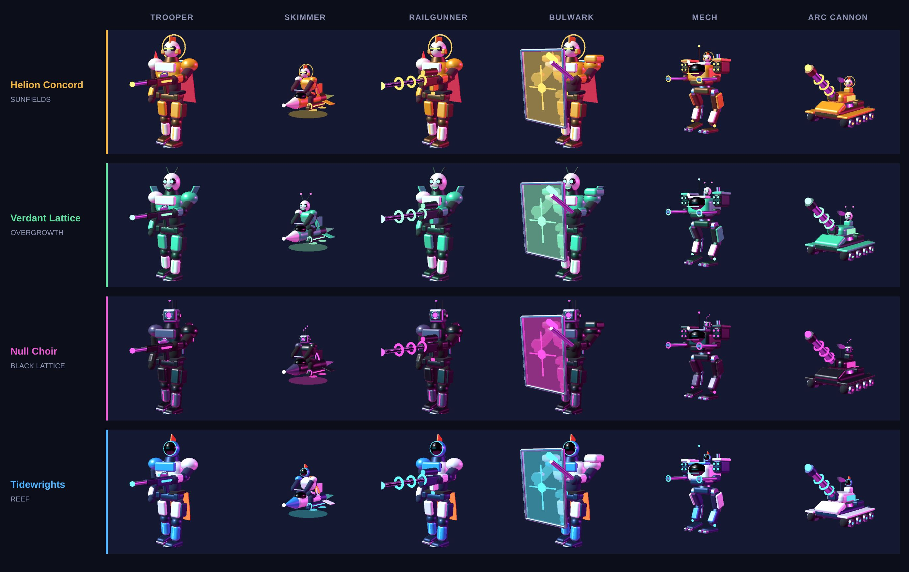
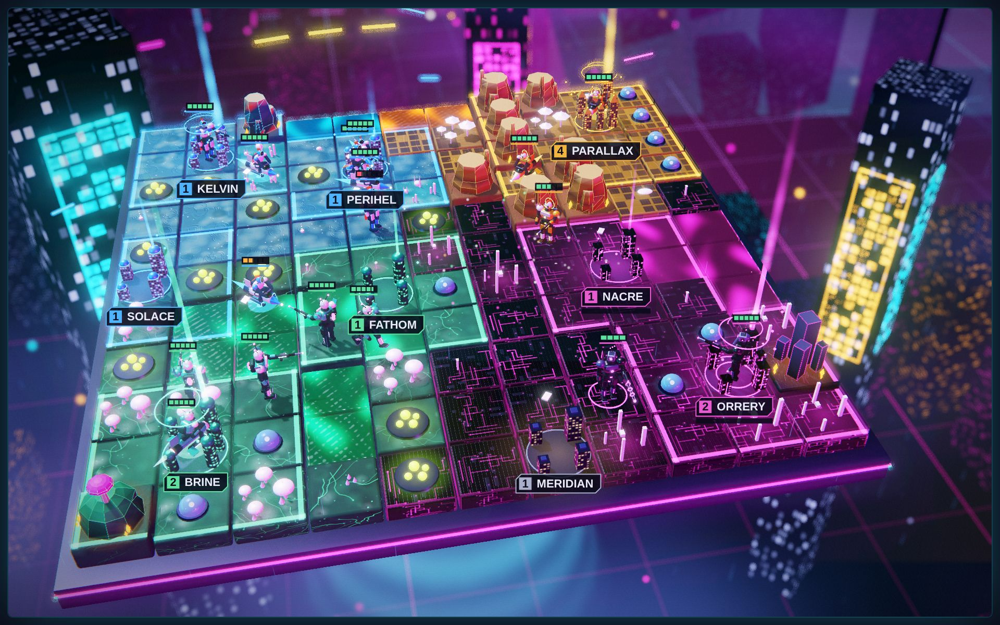
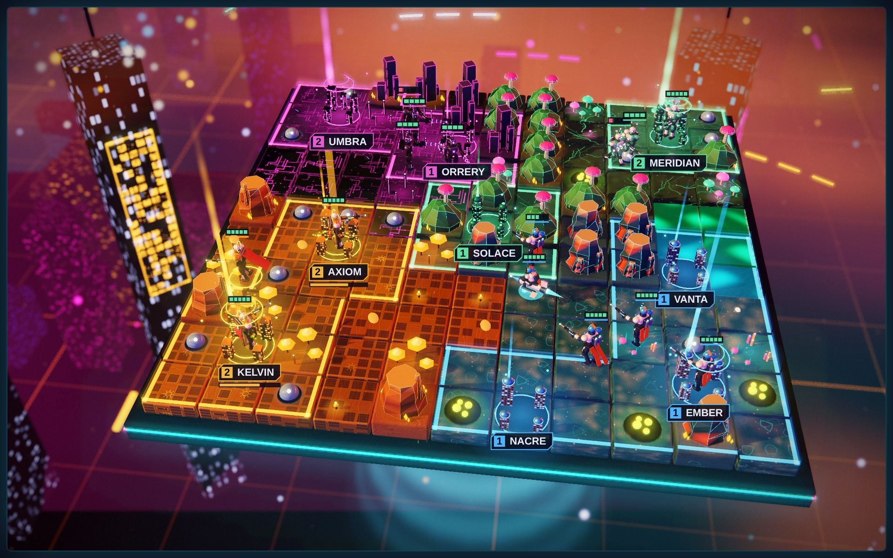
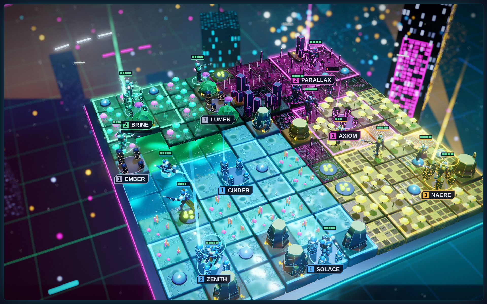
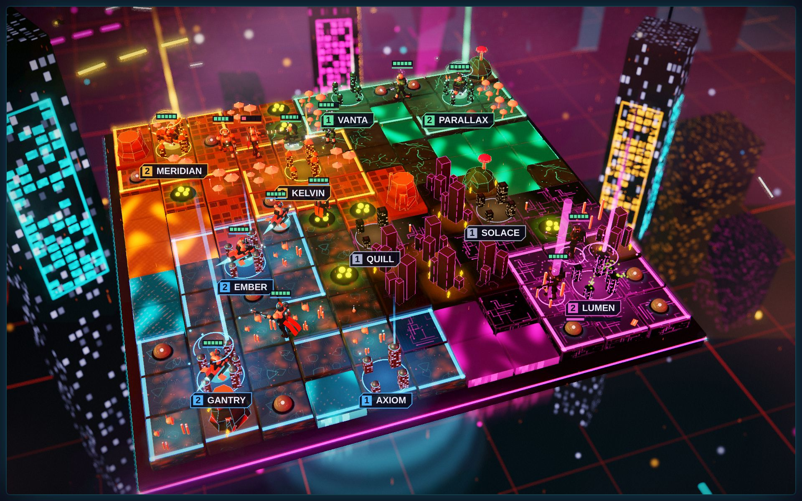
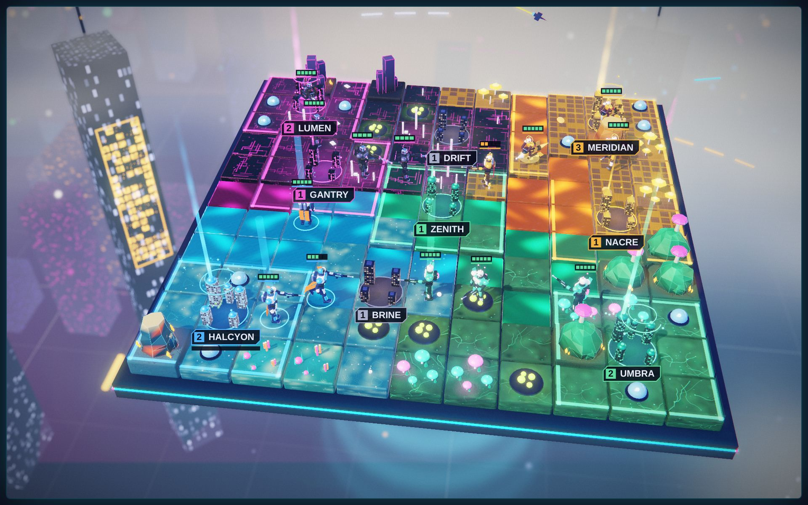

# The world of Shardfall

A field guide to the Shard, the four cultures arguing over it, and the hardware they are
arguing with.

> **A note on canon.** Names, traits, homelands, units and skies on this page are exactly
> what is in the game. The gossip around them is this document's own, written to make the
> tables more fun to read. If you want numbers, [GAMEPLAY.md](GAMEPLAY.md) has all of them
> and none of the gossip.

- [The Shard](#the-shard)
- [Flux](#flux)
- [The four cultures](#the-four-cultures)
- [The hardware](#the-hardware)
- [Outposts](#outposts)
- [The five skies](#the-five-skies)
- [Design notes](#design-notes)

## The Shard

One broken slab of world, square, somewhere between 81 and 169 tiles depending on how much of
it you asked for. It hangs over a city that does not seem to have noticed there is a war on:
the towers keep their lights on, the air traffic keeps its lanes, and somebody up there is
still paying for holographic advertising.

Nobody on the Shard knows what is on most of it. You start with sixteen tiles of certainty
and a great deal of dark circuitry. Everything else has to be walked to.

There are thirty turns. Nobody in the game explains why thirty. The leading theory among the
Tidewrights is that something is coming. The leading theory among the Null Choir is that
thirty is when the vote is counted.

## Flux

The one currency. Cities produce it, and everything costs it: soldiers, science, and the
harvesting rigs that turn a patch of algae into a bigger city.

You cannot eat flux, bank it for points, or take it with you. A commander who ends the game
with forty flux in reserve has learned an important lesson about turn 30.

## The four cultures

Each culture owns a quarter of the map, and you can tell whose land you are standing on by
looking down. The same four kinds of terrain are completely different places depending on
who lives there.

### Helion Concord

> _Solar-sail merchant priests who tithe every sunrise._

|                 |                                                                   |
| --------------- | ----------------------------------------------------------------- |
| **Color**       | Gold                                                              |
| **Trait**       | **Dividend.** The capital yields +2 flux every turn               |
| **Starts with** | Excavation                                                        |
| **Homeland**    | **The Sunfields**: gold mesas, solar orchards and molten channels |
| **Terrain**     | Sunplate flats · Parasol orchard · Mesa · Molten channel          |
| **Look**        | Halos, crests, capes. Dressed for a procession at all times       |

The Concord believes the sun is a business partner, and that the partnership is going well.
Their capital pays double from the first morning, which they consider only natural. Their
soldiers wear halos, not because they are holy but because it is important to be seen.

The Sunfields are plated in gold panels with channels of something molten running between
them. The parasols in the orchards are solar collectors. Probably. The Concord does not
discuss yields with outsiders.

**Play them if** you like having more money than everyone else and the simplest opening in
the game: harvest the ore ridge on turn one and your capital levels up immediately.

### Verdant Lattice

> _Gene-gardeners who grow their armor instead of forging it._

|                 |                                                                    |
| --------------- | ------------------------------------------------------------------ |
| **Color**       | Green                                                              |
| **Trait**       | **Regrowth.** Every unit mends 2 HP each turn, even after fighting |
| **Starts with** | Hydroponics                                                        |
| **Homeland**    | **The Overgrowth**: moss beds, giant mushrooms and glowing lagoons |
| **Terrain**     | Moss beds · Sporewood · Root mound · Algal lagoon                  |
| **Look**        | Bulb heads, antennae, very large eyes. Armor with a faint pulse    |

The Lattice does not build things. It encourages them. A Verdant Bulwark's shield was a seed
last season, and their Mechs are widely suspected of being ripe rather than finished.

Wounds close on their own, which makes the Lattice maddening to fight: you win an exchange,
come back next turn, and discover it has been politely undone. The Overgrowth is soft
underfoot and lit from below, and the mushrooms are taller than the soldiers.

**Play them if** you like winning by refusing to lose. Trade blows constantly; you get
yours back.

### Null Choir

> _A machine collective that votes in a single voice._

|                 |                                                                         |
| --------------- | ----------------------------------------------------------------------- |
| **Color**       | Magenta                                                                 |
| **Trait**       | **Fabricators.** Units cost 1 flux less, never below 2                  |
| **Starts with** | Ballistics                                                              |
| **Homeland**    | **The Black Lattice**: obsidian glass, pylon fields and mercury pools   |
| **Terrain**     | Black glass · Pylon field · Monolith stack · Mercury pool               |
| **Look**        | Black plate, one lens where a face would be, magenta light in the seams |

Every unit of the Choir is the Choir. Ask a Trooper its name and you get the name of the
whole army and a slightly offended pause.

They make hardware cheaper than anyone else, because the factory is also the workforce and
does not charge itself. The Black Lattice is a circuit board the size of a country: glass
floors with traces of light running through them, fields of pylons, and pools of mercury
that are very flat and very still until something walks past.

**Play them if** you like ranged units and a discount. Railgunners are available from the
first turn. The Trooper discount does nothing, so aim for the expensive toys.

### Tidewrights

> _Drift-city navigators raised on drowned worlds._

|                 |                                                                   |
| --------------- | ----------------------------------------------------------------- |
| **Color**       | Blue                                                              |
| **Trait**       | **Tideborn.** Units cross liquid from turn one                    |
| **Starts with** | Thrusters                                                         |
| **Homeland**    | **The Reef**: tidal flats, coral gardens and turquoise lagoons    |
| **Terrain**     | Tidal flats · Coral garden · Sea stack · Lagoon                   |
| **Look**        | Dive helmets with a dark visor, white plate, an orange fin on top |

The Tidewrights lost their first world to the water and decided the water had a point.
Where everyone else sees a lagoon as the edge of the map, a Tidewright sees a road.

They start with Skimmers, so they scout faster than anyone, and on a wet map they will be
sitting on outposts you have not found a way to reach. The Reef is the only homeland that
looks like a nice place to live.

**Play them if** you chose the Archipelago. On Highlands, play them for the helmets.

## The hardware

Six kinds of unit, shared by all four cultures. Each culture builds them to the same spec
and paints them to its own taste.

| Unit           | What it is                              | What it is for                             |
| -------------- | --------------------------------------- | ------------------------------------------ |
| **Trooper**    | A soldier with a rifle and opinions     | Everything, adequately. Holding cities     |
| **Skimmer**    | A rider on a hover-sled                 | Scouting, and getting to outposts first    |
| **Railgunner** | A soldier with a much longer rifle      | Hurting things that cannot reach back      |
| **Bulwark**    | A soldier carrying a hard-light wall    | Standing in a doorway and not dying        |
| **Mech**       | A two-legged walker with a pilot on top | Taking cities that do not want to be taken |
| **Arc Cannon** | A tracked gun with a nervous operator   | Deleting things from three tiles away      |

The Arc Cannon has a defense of zero. This is not a typo. The operator knows.

## Outposts

Neutral cities scattered across the Shard, with names like **Vanta**, **Orrery**,
**Perihel**, **Halcyon**, **Fathom** and **Umbra**. They belong to nobody, defend themselves
not at all, and go to whoever stands on them for a full turn.

Nobody knows who built them. They were here before the cultures arrived, they have lights
on, and they are entirely unbothered about who owns them this week. Every culture has a
theory. The Concord's theory is that they are an investment opportunity.

## The five skies

A game of Shardfall happens under one of five skies. The sky changes the light, the fog, the
weather, the reflections in every piece of armor, and the color grade of the whole picture.
It changes nothing about the rules.

|                                             |                                                                                                                                            |
| ------------------------------------------- | ------------------------------------------------------------------------------------------------------------------------------------------ |
|         | **Neon Storm.** Rain, lightning, magenta and cyan on wet metal. The default mood of the Shard, and the one the city below seems to prefer. |
|          | **Solar Dusk.** A low sun, long shadows, dust in the air. The Concord insists this is simply what the sky is supposed to look like.        |
|      | **Aurora Night.** Snow falling through cold teal light. Quiet, and the best sky for seeing the Verdant glow.                               |
|  | **Crimson Eclipse.** Something is in front of the sun. Embers drift upward. Everyone agrees not to discuss it until the war is over.       |
|          | **Cloud Dawn.** Pale, bright and clear. No weather at all. Somehow the most unsettling one.                                                |

## Design notes

For anyone extending the world, the rules the existing content follows:

**Every culture is one sentence, one color, one silhouette and one rule.** If you cannot say
who they are in a line, tell them apart at thumbnail size, or remember what their trait does
after one game, they are not finished.

**A trait should change how you play, not just your numbers.** Tideborn changes where you can
walk. Regrowth changes whether a trade was worth it. Dividend changes what you can afford on
turn two. Fabricators is the weakest of the four by this standard, and it shows in the win
rates.

**Homelands recolor the rules without changing them.** A Mesa and a Monolith stack are both
"ridge". A player who learns the game as one culture can read any other culture's land. The
variety is all for the eyes.

**The city below is indifferent.** The backdrop never reacts to the game. That is deliberate:
it makes the war feel small and the world feel large.

**Keep it a little funny.** The Arc Cannon operator is nervous. The Choir is offended when
you ask its name. Nobody on the Shard takes the Shard as seriously as the player does.
